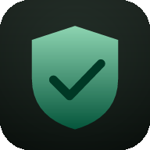

# Hole Shield for Android TV, phones and desktop

A self-contained, Pi-hole-style DNS filter for Android TV, Google TV, Android
phones, Windows, Linux and macOS. Hole Shield runs its own gravity engine, query log, statistics, web
dashboard/API and an optional LAN DNS listener. It also runs a DNS-only VPN on
the device so every app's lookups are filtered without root.

No Gradle, AndroidX or third-party libraries. Pure Java, built with the Android
SDK command-line tools.



## Download

The latest published prebuilt APK and Play AAB are attached to the
[GitHub release](https://github.com/dinosnore1/pihole-tv/releases/latest).
The current source build is **2.3.2** and is published to the beta channel. This is the
new `com.dino.holeshield` package; uninstall the old `com.dino.pihole` app
before installing it.

- **Package:** `com.dino.holeshield`
- **Version:** 2.3.2 (`versionCode 9`)
- **Desktop:** Java 17 Swing app with a bundled-runtime installer for Windows,
  Linux and macOS (see `desktop/README.md`)
- **Launcher label:** **Hole Shield** on phones, **Hole Shield TV** on televisions
- **Minimum Android:** 8.0 (API 26)
- **Target/compile SDK:** 36 (Android 16)

## Desktop port

The `desktop/` directory contains a native Windows/Linux/macOS build with the
same gravity format, rules, query log and web dashboard as the Android app. It
runs local UDP/TCP DNS, supports DoH or plain upstreams, has a Swing control
panel and tray controls, and ships as a portable JAR plus native installers.

```bash
./desktop/tools/test.sh       # 117 headless core checks
./desktop/tools/package.sh    # app image + DMG/PKG, DEB/RPM or MSI/EXE
```

See [`desktop/README.md`](desktop/README.md) for setup, port 53 permissions and
platform packaging notes. The GitHub Actions workflow
`.github/workflows/desktop.yml` builds all three platforms.

## What it does

- **System-wide filtering on the device.** A local `VpnService` routes IPv4
  and IPv6 DNS to the embedded resolver. The VPN does not carry video, downloads
  or general LAN traffic.
- **Embedded gravity database.** Ships with a conservative seed list and a
  maximum preset of 25 maintained ad, tracker, malware/phishing and TV-telemetry lists, including
  Hagezi Ultimate, OISD Big, 1Hosts Xtra, AdGuard CNAME ads, Perflyst SmartTV
  and classic hosts lists. Tracker/telemetry and malware/phishing categories can be
  added or removed independently. The web dashboard shows Ads, Trackers and
  Malware domain counts, with icon-only sun/moon theme and refresh buttons, and a single
  compact pause pill/dropdown with an in-place countdown and dynamic width, a
  shield tab icon, a logout button and a compact centered Material You login page. Multiple list URLs are
  supported.
- **Pi-hole-style rules.** Exact allow/deny, wildcard allow/deny and regex rules.
  Allow rules take precedence over gravity. `*.example.com` matches strict
  subdomains, not the apex; `/regex/` supports Java regular expressions.
- **CNAME inspection.** If an upstream answer points at a blocked CNAME target,
  the answer is turned into a blocked reply.
- **Local DNS cache**, DoH or DNS-over-TLS upstream (Cloudflare by default)
  and a plain-DNS fallback. Choose the blocked response: `0.0.0.0`, NXDOMAIN or
  NODATA.
- **Runtime category switches** for Ads, Trackers and Malware. The compact
  64-bit gravity index makes these instant and keeps a 600k-domain list to a few
  megabytes.
- **Blocking hours.** Optional daily window (overnight ranges supported) pauses
  blocking automatically outside the window and resumes at the start time.
- **Per-client rules** for LAN clients: `192.168.1.50 ads.example.com` blocks,
  `192.168.1.50 !example.com` allows, and `*.example.com` matches subdomains.
- **Backup and restore.** Export settings, custom rules, blocklist sources and
  the query log as one JSON file through the system document picker.
- **Update channel.** Choose Stable, Beta or Off in Settings → Updates and run
  Check for updates. The app reads a public release manifest and opens the
  release page when a newer build is available; it never installs silently.
- **Pause / resume** indefinitely or for 5/30 minutes, with timer state persisted
  across restarts. Notification actions, a Quick Settings tile and a home-screen
  widget expose pause, resume and status.
- **Query log and counters** for queries, blocks, cache hits, forwards, errors,
  clients, types, top domains and upstreams. The log survives app restarts and
  is rolled over daily.
- **Web dashboard** at `http://DEVICE-IP:8080/admin/`, with optional
  username/password login. Desktop uses a sticky section sidebar with scroll
  spy; phones use a fixed icon bottom bar. New passwords are stored as PBKDF2 hashes, repeated
  failures trigger a lockout, and the Log out menu can end this browser or every
  session. The
  dashboard adds a live, 24-hour, week and month chart, blocked-by-category breakdown, runtime category
  switches, per-list health, one-tap allow/block from the query log, and CSV/JSON
  export.
- **LAN DNS server** on UDP and TCP port **5354** for other devices on the LAN
  (IPv4). The dashboard and LAN DNS listener are **off by default**; a first-run
  setup screen explains the exposure and lets you opt in.
- **Pi-hole-compatible API subset** for dashboards and scripts (see below).
- **Launcher shortcuts** for "Pause 30 min" and "Query log", plus a network
  details screen with copyable dashboard/DNS addresses.
- **D-pad and touch UI.** The same screens work with a TV remote and with a
  finger. TV uses a persistent left navigation rail, and phones use a persistent
  icon-based bottom bar for Home, Server, Gravity & rules, Query log and Settings. A **TV safe area** setting (Settings → System)
  is off by default and can inset the layout for TVs that crop the outer edges. Log rows are focusable on TV and expose quick allow/block actions. TV keeps its focus rings and immersive fullscreen; phones use a compact
  layout, show the system bars and rebuild cleanly between portrait and
  landscape.
- **Material You theme.** Dark and light Material 3 palettes with tonal cards,
  pill buttons and focus rings. Choose System, Dark or Light in
  Settings → Appearance. Android 12+ uses the system's dynamic accent colors in
  dark mode; older devices use a matching scheme generated from the Hole Shield
  green.

## Design

The TV and phone app, web dashboard, launcher icon and TV banner share one
Material 3 dark palette. The interface stays dark in both system light and dark
mode. On TV it preserves D-pad focus states and immersive fullscreen; on phones
it uses compact spacing, touch-sized controls, visible status/navigation bars and
a responsive portrait/landscape layout. On Android 12+ the app reads the
system's dynamic accent colors by resource name; on Android 8–11 it falls back to
the bundled green scheme.

Hole Shield uses edge-to-edge layout on Android 15+ and pads the content for the
status bar, navigation bar and keyboard. Android 13+ asks for notification
permission when the app opens so the ongoing protection notification can be
shown.

## Requirements

- Android TV / Google TV or an Android phone on **Android 8.0 (API 26) or
  newer**.
- No root. Root is only needed if you want to serve DNS on the standard **port
  53**; unrooted Android cannot bind it, so this app uses **5354** for LAN DNS.
- To build: JDK 17 and Android SDK platform 36 + build-tools 36.x. The build
  scripts default to `~/Library/Android/sdk` and
  `/opt/homebrew/opt/openjdk@17`.

## Build

```bash
cd ~/pihole-tv
./tools/test.sh          # 133 desktop checks for DNS, packet, list, hash and web-auth code
./build.sh               # writes build/holeshield.apk (sideload signing key)
./tools/build-aab.sh     # writes build/holeshield.aab (Play upload key) + test APK
```

GitHub Actions runs the desktop checks and builds the APK on pushes and pull
requests (`.github/workflows/android.yml`).

`build.sh` signs with `~/.android/pihole-tv.keystore` (created on first use) and
is intended for direct APK distribution. `tools/build-aab.sh` signs the Play
bundle with `~/.android/holeshield-upload.jks`; keep that keystore and the
password file backed up. The upload key is only an upload identity — Play App
Signing re-signs the delivered app.

The bundle script also produces `build/universal/universal.apk`, a universal APK
built from the signed AAB. Use it to test exactly what Play will deliver.

### Install a sideload build

```bash
adb connect DEVICE_IP:5555        # wireless debugging/TV; or just use USB
adb install -r build/holeshield.apk
adb shell am start -n com.dino.holeshield/.MainActivity
```

The package changed from `com.dino.pihole` to `com.dino.holeshield`, so Android
treats this as a new app. Uninstall the old package before installing Hole
Shield; settings and statistics do not migrate.

## First run

1. Open **Hole Shield TV** on a television or **Hole Shield** on a phone, then
   select **Turn on protection**.
2. Read the in-app VPN disclosure and tap **Agree and continue**, then approve
   Android's VPN prompt. This is a one-time permission; boot auto-start uses it
   afterwards.
3. Allow notifications when Android asks. The ongoing notification is required
   for the foreground VPN service.
4. In the device's network settings, set **Private DNS** to **Off**. A strict
   DoT hostname bypasses the VPN and can break filtering; the app shows an amber
   warning while it is on.
5. Open the dashboard:
   `http://DEVICE_IP:8080/admin/` (replace with the device's LAN IP).
6. Optional but recommended: set a **Web username and password** in the app's
   Settings before exposing the dashboard to your LAN.
7. Run **Update gravity now** to download the maximum preset (up to 600k
   deduplicated domains). The first download can take a few minutes.
8. Run **Test protection**. `doubleclick.net` should resolve to `0.0.0.0` (or
   return no address) while `example.com` resolves normally.

On phones, Android shows a VPN key in the status bar while protection is on. The
app asks for the VPN permission only once; it does not route normal traffic
through a remote server.

The app remembers protection and can resume it after a reboot. Some TV firmware
and phone battery managers limit background starts; opening the app once after a
reboot works around that.

## How resolution works

```
Device app
  │  DNS query
  ▼
tun 10.111.221.1 / [fd00:111:221::1]:53
  ▼
DnsEngine
  ├─ allow rule?        → resolve normally (allow wins)
  ├─ gravity/deny?      → 0.0.0.0 / NODATA
  ├─ cache hit?         → cached answer
  └─ DoH / plain DNS    → answer
        │
        └─ inspect CNAME targets and block if needed
```

The LAN DNS listener uses the same engine, so the device and LAN clients share
rules, statistics and the cache.

Resolution order is intentionally simple: **allow rules → gravity/deny →
cache → DoH → plain DNS**. If the local gravity engine is off or blocking is
paused, lookups still resolve but no blocking rules are applied. CNAME targets
are checked only when blocking is active and the original query was not allowed.

## Dashboard and API

Default dashboard: `http://DEVICE-IP:8080/admin/`

Default LAN DNS: `DEVICE-IP:5354` (UDP and TCP)

Set a web password under **Settings → Web password**. Empty means no password
and the dashboard/API is open to anyone who can reach the device's LAN address.
Optionally set **Settings → Web username** to require both a username and a
password. A username is only enforced when a password is also set.

When a password is set, log in with both fields if a username is configured:

```bash
# Password-only login (username left blank)
curl -s -X POST http://192.168.1.50:8080/api/auth \
  -H 'Content-Type: application/json' \
  -d '{"password":"your-password"}'

# Username + password login
curl -s -X POST http://192.168.1.50:8080/api/auth \
  -H 'Content-Type: application/json' \
  -d '{"username":"admin","password":"your-password"}'

# Use the returned sid as X-FTL-SID (or as a sid cookie)
curl -s -H 'X-FTL-SID: <sid>' \
  http://192.168.1.50:8080/api/stats/summary
```

The v5 compatibility endpoint accepts `auth=password`, or
`auth=username:password` when a username is configured:

```bash
curl -s 'http://192.168.1.50:8080/admin/api.php?summaryRaw&auth=your-password'
curl -s 'http://192.168.1.50:8080/admin/api.php?summaryRaw&auth=admin:your-password'
```

### API endpoints

| Endpoint | Method | Purpose |
|---|---|---|
| `/api/health` | GET | Liveness check (no auth required). |
| `/api/auth` | POST | Username/password → session ID. |
| `/api/stats/summary` | GET | Query counters, gravity size, clients, blocking state. |
| `/api/stats/top_domains` | GET | `blocked=true|false`, `count=1..100`. |
| `/api/stats/top_clients` | GET | Top clients; `count=1..100`. |
| `/api/stats/query_types` | GET | A/AAAA/other counts. |
| `/api/stats/upstreams` | GET | `doh`, `plain`, `cache`, `gravity`, `custom`, etc. |
| `/api/queries` | GET | Query log; `length`, `start`, `blocked`, `client`, `domain`, `search`. |
| `/api/dns/blocking` | GET | Current state and pause timer. |
| `/api/dns/blocking` | POST | `{"blocking":false,"timer":300}`; `timer=0` means indefinite. |
| `/api/domains/{allow|deny}/{exact|wildcard|regex}` | GET | List matching rules. |
| `/api/domains/{allow|deny}/{exact|wildcard|regex}` | POST | Add `{"domain":"..."}`. |
| `/api/domains/{allow|deny}/{exact|wildcard|regex}` | DELETE | `?domain=...`. |
| `/api/lists` | GET | Blocklist URLs as numbered entries. |
| `/api/lists` | POST | Add `{"address":"https://..."}`. |
| `/api/lists/{id}` | DELETE | Remove a list by its numeric id. |
| `/api/action/gravity` | POST | Start a gravity update. |
| `/api/action/flush` | POST | Flush the DNS cache. |
| `/api/info/host` | GET | LAN IP, ports, version and listener state. |
| `/api/info/version` | GET | App/API version. |
| `/admin/api.php` | GET | Pi-hole v5 subset: `summaryRaw`, `status`, `enable`, `disable`, `topItems`, `recentBlocked`, `versions`. |

`/api/stats/summary` returns `gravity.last_update` as Unix seconds for Pi-hole
compatibility and `gravity.last_update_ms` for the bundled dashboard.

### Pi-hole compatibility notes

Hole Shield is a **Pi-hole-style embedded server**, not a full Pi-hole
installation. The implemented API covers the dashboard, blocking/pause, query
log, stats, domain rules, lists, gravity and cache. The following are **not**
implemented:

- local DNS records, conditional forwarding, upstream group management;
- per-client groups and group assignments;
- DHCP/DHCPv6;
- DNSSEC validation;
- complete Pi-hole v5/v6 API coverage (network tables, teleporter,
  diagnostics, messages, etc.);
- binding LAN DNS to port 53 (root-only on Android).

Scripts that only need stats, blocking, rules, lists and query history work.
If you need full Pi-hole behavior, run Pi-hole on a separate machine and use its
dashboard/API; Hole Shield deliberately remains self-contained.

## LAN DNS

The device's own DNS goes through the VPN on port 53. For other devices, enable
**Settings → LAN DNS server** and point them at:

```
DNS server: 192.168.1.50
Port:       5354
```

Both UDP and TCP are supported. Many routers and devices only accept port 53,
which cannot be bound by an unrooted Android app. On those devices you can use a
router/firewall redirect from 53 to 5354, or run a small forwarder on another
machine. The dashboard shows the current listener state and port.

The LAN listener is IPv4 (`0.0.0.0`). It uses the same blocklists, rules,
pause state, CNAME checks and cache as the device. On a phone, keep Wi-Fi
connected and use the phone's Wi-Fi address; the VPN address is not reachable
from other LAN devices.

## Settings

| Setting | Meaning |
|---|---|
| Protection | Turn the DNS-only VPN on or off. |
| Start at boot | Resume protection after the device restarts. |
| Gravity blocking | Apply downloaded lists and custom rules. Off = resolve everything. |
| Block subdomains of list entries | Match `ads.example.com` when `example.com` is on a gravity list. |
| Block CNAME targets | Inspect upstream CNAMEs and block answers pointing at blocked names. |
| Force all DNS through the filter | Add routes for common public resolvers and capture hard-coded DNS. |
| Fallback DNS | `Encrypted (DoH)` tries DoH first, then plain DNS; `Plain DNS` uses plain only; `Off` disables upstream resolution. |
| Encrypted DNS server | DoH URL; Cloudflare by default. |
| Web dashboard / port | Enable/disable and choose the HTTP port (default 8080). |
| Web username | Optional dashboard/API username; requires a password. |
| Web password | Optional dashboard/API password. Empty = open. |
| LAN DNS server / port | Enable/disable the UDP+TCP LAN listener (default 5354). |
| Blocklist sources | One hosts/adblock URL per line. |
| Add maximum blocklists | Append the curated maximum preset without removing custom sources. |
| Update gravity now | Download all sources and reload the engine. |
| Test protection | Resolve a known ad domain through the active VPN. |

Changes to ports, fallback, capture or LAN DNS restart the VPN automatically.
Gravity/rule changes are applied live.

## Rules

- **Exact:** `ads.example.com` blocks only that name.
- **Wildcard:** `*.example.com` blocks strict subdomains such as
  `ads.example.com`, but not `example.com` itself.
- **Regex:** `/^ads[0-9]+\.example\.net$/` uses Java regex matching.
- **Allow rules** are evaluated before gravity and custom deny rules. An exact
  allow for a CNAME target also prevents CNAME blocking.
- Custom rules are stored in the app's private preferences and persist across
  restarts.

## Privacy and security

Hole Shield has no accounts, analytics, ads or crash reporting, and does not
upload query data. The full policy is in
[`docs/privacy.html`](docs/privacy.html) and is published at
<https://dinosnore1.github.io/holeshield-privacy/privacy.html>.

- DNS queries are resolved on the device against local lists, then forwarded to
  the configured DoH endpoint over HTTPS. If DoH is unavailable, or if plain
  fallback is selected, queries go to plain DNS (`1.1.1.1`, `8.8.8.8`,
  `9.9.9.9`).
- Blocklist downloads go only to the URLs you configure.
- The query log (domain, time, client) and statistics stay on the device. They
  are never uploaded by the app.
- The dashboard/API listens on the LAN over **plain HTTP**. There is no TLS.
  Use it only on a trusted LAN. Set a web password if other people or untrusted
  devices share the network.
- The web username and password are stored in the app's private
  `SharedPreferences` and are not encrypted at rest. Anyone with root or a full
  device backup can read them. Changing the login invalidates existing dashboard
  sessions.
- The VPN is DNS-only. Video, downloads and normal LAN traffic are not routed
  through the app.
- LAN DNS and the dashboard are off by default. When enabled, other devices on
  the network can query this device.

## Google Play release

Store text, declarations and asset requirements are collected in
[`store/listing.md`](store/listing.md). The short version:

1. Create the app in Play Console with the **Hole Shield** name and
   `com.dino.holeshield` package.
2. Upload `build/holeshield.aab` to **Internal testing**, then promote the same
   build to **Closed testing**.
3. Complete the VpnService declaration (device security/firewall, no remote
   tunnel), the `specialUse` foreground-service declaration, Data safety,
   content rating, ads declaration and the public privacy policy URL.
4. Provide the feature graphic, 512×512 icon, phone screenshots, TV
   screenshots/banner and the two unlisted VPN declaration videos in
   `store/videos/`.
5. Keep at least 12 testers opted in for 14 continuous days, then apply for
   production access.

Play App Signing re-signs the upload; keep the upload keystore safe but do not
expect its certificate in the Play-delivered APK.

## Troubleshooting

| Symptom | Check |
|---|---|
| Dashboard does not load | Confirm protection is on, the device IP is correct, and the web dashboard is enabled. Try `curl http://DEVICE-IP:8080/api/health`. |
| `401 authentication required` | Set/enter the web login, then use the returned `X-FTL-SID` or the v5 `auth=` parameter (`user:pass` when a username is set). |
| LAN DNS refused | Enable **LAN DNS server**, check the port, and verify the client supports a non-53 DNS port. |
| Ads still appear | Same-domain ads (YouTube in-stream), app-level DoH, or the query was allowed. Check the query log and test `doubleclick.net`. |
| A service breaks after maximum lists | The maximum preset is aggressive. Add an exact allow rule for the service's domain instead of disabling all filtering. |
| No internet while protected | Set fallback to DoH/plain, check Private DNS is Off, and verify the upstream is reachable. |
| Gravity is 0 / update fails | Check the list URL from the device's network, then run **Update gravity now** again. |
| Protection does not resume after reboot | Some TV firmware and phone battery managers block background starts; open the app once. |

## Project layout

```
AndroidManifest.xml          leanback entry, DNS VPN service, boot receiver
src/com/dino/holeshield/
  MainActivity.java          TV/phone UI, settings, rules, query log
  DnsVpnService.java         device tun lifecycle, packet loop, notification
  DnsEngine.java             allow/gravity/CNAME resolution, logging
  DnsUpstream.java           cache, DoH, plain DNS, startup IP seeding
  DnsPacket.java             DNS parsing, replies, CNAME/TTL helpers (pure Java)
  IpPacket.java              IPv4/IPv6 UDP reply builder (pure Java)
  Blocklist.java             gravity lists, custom rules, downloads
  Blocklists.java            maximum preset and existing-install migration
  HostsParser.java           hosts/adblock line parsing and IP rejection
  Stats.java                 persisted daily counters and query log
  WebServer.java             dashboard HTTP server, v6/v5 API subset, auth
  LanDnsServer.java          UDP + TCP LAN DNS listener
  Prefs.java                 persisted settings and pause state
  NetInfo.java               LAN IP (Wi-Fi/Ethernet preferred) and dashboard URL
  Device.java                TV/phone detection and labels
  PiholeClient.java          legacy external-Pi-hole client (inactive)
  Ui.java, Backdrop.java, ShieldView.java
assets/blocklist.txt         bundled seed list
assets/dashboard.html        responsive web dashboard
res/drawable/                launcher icon, TV banner, notification icon
res/values*/                 phone/TV launcher labels and theme colours
docs/privacy.html            Play-ready privacy policy
store/                       listing text, declarations and store artwork
tools/TestDns.java           desktop checks for DNS, packet and list code
tools/build-aab.sh           signed AAB + universal test APK
build.sh                     no-Gradle APK build
```

## Tests

`./tools/test.sh` runs **133 desktop checks** covering query parsing (including
rejection of responses/non-standard opcodes), stripping IPv4/IPv6/UDP headers
from tun packets, blocked A/AAAA/HTTPS replies in all three blocked-response
modes, answer-address extraction, TTL selection, IPv4/IPv6 UDP replies and
checksums, address/port swapping, payload preservation, hosts/adblock line
parsing, blocklist preset merging, PBKDF2 login records and compact gravity
merging/lookup.

The app has been exercised on:

- a Hisense VU Smart TV (Android 11 / API 30, armeabi-v7a, 1920×1080) at
  `192.168.1.19`;
- a Xiaomi/Redmi `M2012K11AI` phone (Android 17 / API 37, 1080×2400) in portrait
  and landscape (previous build);
- clean Android 15 / API 35 and Android 16 / API 36 emulators (1080×1920) for
  the current `2.3.1` build and the Play screenshots.

Verified across these devices:

- dashboard and API over the LAN (the TV was also exercised with an
  authenticated session);
- maximum preset update (519,040 deduplicated domains on the phone; 518,426 on
  the TV) and list add/delete;
- device-originated filtering and LAN DNS over both UDP and TCP;
- blocked/allow/wildcard/regex rules and CNAME blocking;
- pause, timed auto-resume and cache flush;
- DoH upstream (`doh`) and plain fallback;
- v5 compatibility (`summaryRaw`, status, enable/disable);
- protection restart on relaunch and the D-pad TV UI.

Current `2.3.1` build extras verified on the TV with the signed AAB test APK:

- in-app VPN disclosure before Android's VPN prompt;
- `specialUse` foreground service starts and stays in the foreground;
- dashboard host shows `Hole Shield TV`, LAN DNS on 5354, blocking on;
- web login with username + password: `/api/auth`, `X-FTL-SID` and v5
  `auth=user:pass` verified on the TV; wrong user/password rejected;
- clearing the password also clears the username and reopens the dashboard;
- 25-list maximum preset with tracker/telemetry and malware/phishing categories;
- gravity update on the STB produced 592,615 unique domains (ads 526,615,
  trackers 3,896, malware 153,613);
- URLhaus `02teste.cc` and Phishing Army `0-ilxrc-w285.p9bckp.sbs` →
  `0.0.0.0`, tracker `app-measurement.com` → `0.0.0.0`, while `example.com`
  resolves normally;
- version strings now come from the installed package (`2.3.1`);
- `doubleclick.net` → `0.0.0.0`, `example.com` resolves through DoH.
- 2.3.0: notification actions (Pause 30 min / Resume), Quick Settings tile and
  widget are registered; widget pause/resume was exercised with ADB.
- 2.3.0: the dashboard serves the live, 24-hour, week and month chart, category switches, list health,
  query-log allow/block actions and CSV/JSON export; the new UI was exercised
  with jsdom.
- 2.3.0: dashboard and LAN DNS are off by default for new installs; existing
  installs keep their saved choice.

Current `2.3.1` phone checks on the Android 15 and Android 16 emulators:

- notification permission prompt; denying it does not crash the app;
- first-run disclosure → Agree → Android VPN prompt → `PROTECTED`;
- disclosure Cancel leaves protection off and starts no VPN service;
- turning protection off and on again with existing Android consent does not
  repeat the disclosure;
- `specialUse` foreground service (`types=0x40000000`);
- edge-to-edge layout on API 35 and API 36, 1080×1920 portrait;
- start at boot resumes protection and the `specialUse` service on both API
  levels;
- dashboard, query log, gravity/rules and stats screens.

`PiholeClient` is retained only as legacy source; the active UI and resolver use
the embedded engine. An old `usePihole` preference is ignored so upgrades cannot
route DNS around the on-device filter.
